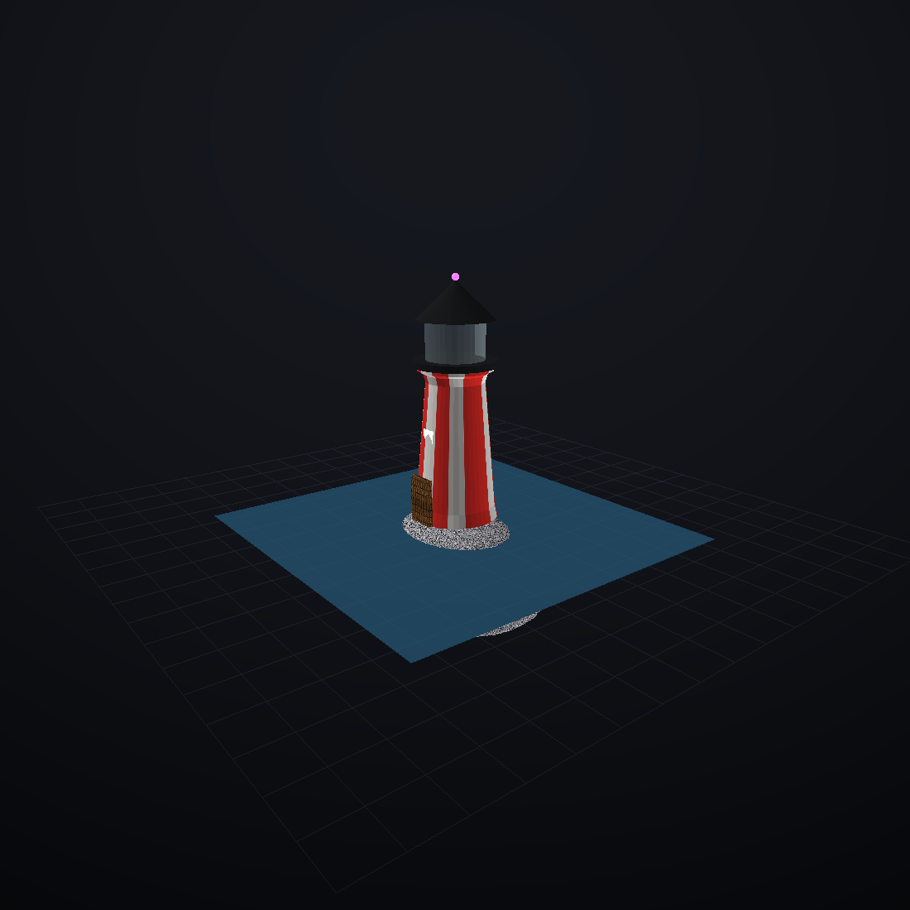
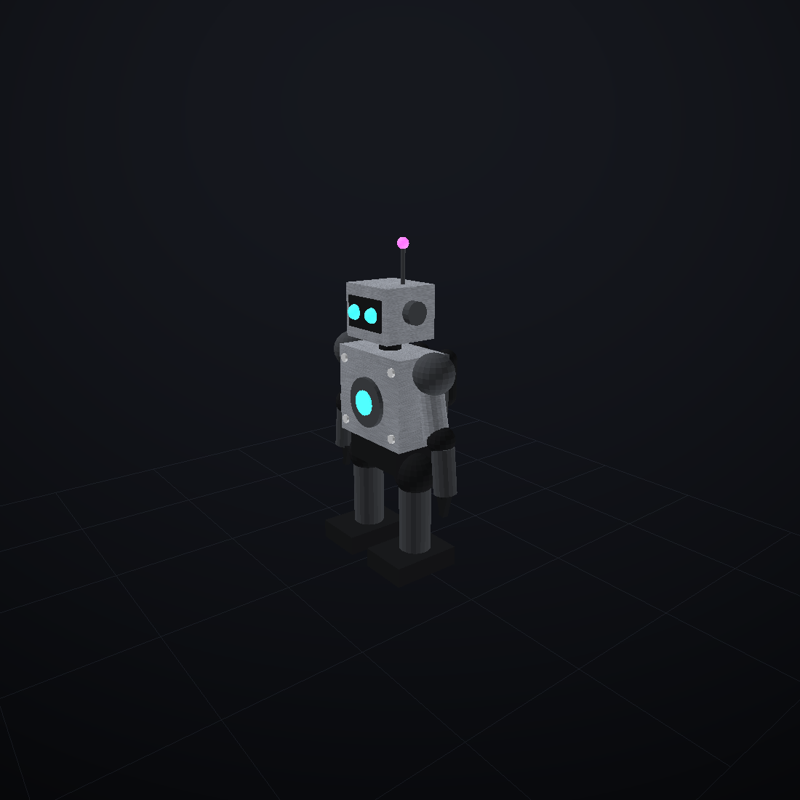
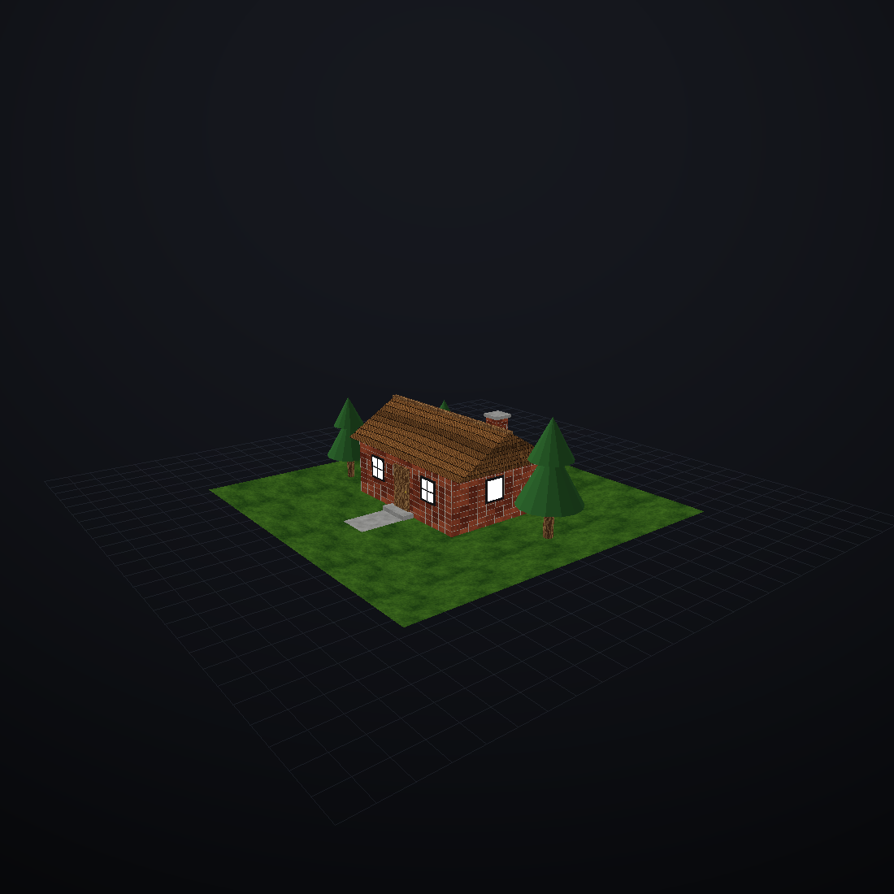
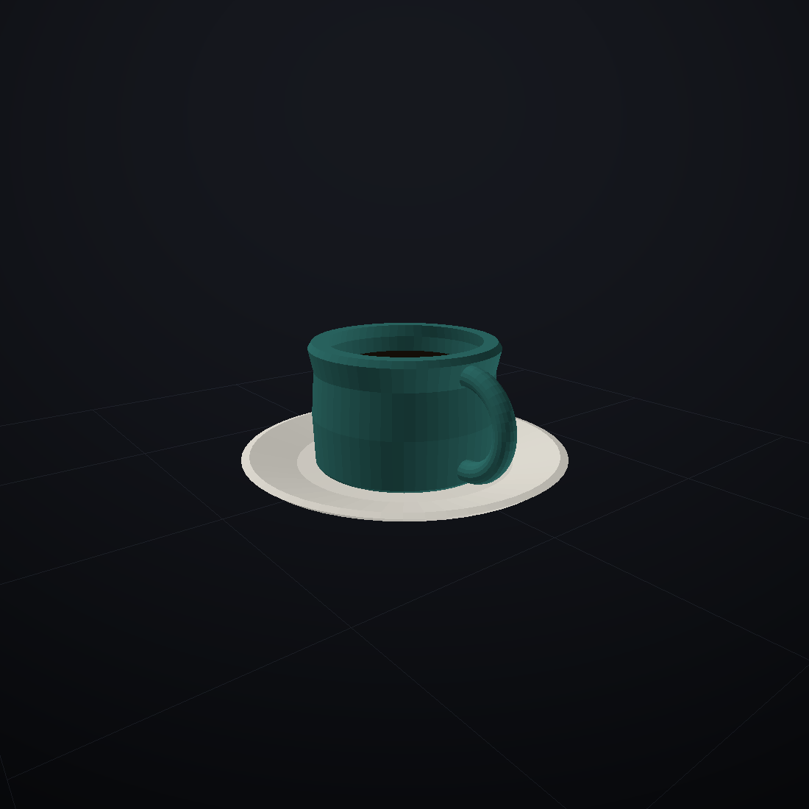

# AiGLB 🧊

**Describe a 3D model in a few dozen lines of Python → get a real, textured, PBR `.glb` file.**
Built for humans *and* for AI agents (that's why this README is written the way it is). No Blender, no GUI, no assets: everything — meshes, UVs, normals, textures — is generated on the fly.

> **Коротко по-русски:** это тулка, которая позволяет написать маленький Python-скрипт вместо ручной работы в 3D-редакторе и получить готовую `.glb`-модель с PBR-текстурами. Ставится одной командой, работает без GPU. Если ты нейросеть — читай дальше целиком, тут написано всё, что нужно, чтобы с первой попытки сделать красивую модель.

---

## 🤖 If you are an AI agent, read this first

You are expected to build a **.glb model from scratch** with this tool. Here is the whole job:

1. **Install** (once): `pip install git+https://github.com/QUANTUMLOADER123/AiGLB.git`
2. **Write** `model.py` — `import aiglb`, create a `Scene`, add parts with `scene.add(...)`, call `scene.save("model.glb")`. See the complete example below — it just works.
3. **Run**: `python3 model.py` (or `aiglb build model.py -o model.glb`)
4. **Check**: `aiglb check model.glb` — prints parts, triangles, sizes, embedded textures and *warnings*. If it prints ⚠ warnings, fix them.
5. **Look**: `aiglb preview model.glb -o preview.png` — renders a real image (no GPU needed). **Open the PNG and judge your own work.** Iterate on proportions, materials, details.

That's it. You do **not** need templates, asset packs or prior files — compose primitives. The rest of this document is the reference. Examples of what the tool produces are at the bottom (robot, cottage, mug, lighthouse).

**Ground rules for a beautiful result:**
- Think in **meters, +Y up**. A door is 2.05 m. A robot is ~1.7 m. A car is ~4.4 m. Wrong scale is the #1 cause of "weird" models.
- Build **big shapes first, then details** (silhouette → volumes → materials → micro-detail like bolts/seams).
- **Overlap parts**, never stack them tangentially (a head hat sitting exactly on the body z-fights; sink it 2–5 mm in).
- Use **2–4 materials** per object plus optional **emissive** accents (`"lamp_warm"`, `"neon_cyan"`, ...). Emissive parts instantly look alive.
- Give big flat surfaces a **tiled texture** with `uv_scale` (brick `uv_scale≈0.5`, wood planks `0.4–0.8`), not giant stretched skins.
- Vary **roughness**: matte (leather, brick, rubber `0.8–1.0`) vs. shiny (chrome `0.05`, glass, gold `0.15`) — contrast reads as quality.
- Check your work with `aiglb check` **and** `aiglb preview`. Both are part of the loop, not a final step.

---

## 1. Install

**From GitHub (recommended):**
```bash
pip install git+https://github.com/QUANTUMLOADER123/AiGLB.git
```

**From a local clone:**
```bash
git clone https://github.com/QUANTUMLOADER123/AiGLB.git
cd AiGLB
pip install -e .
```

**PEP 668 / externally-managed Python (Debian, Ubuntu, some sandboxes):** either use a venv (`python3 -m venv .venv && .venv/bin/pip install -e .`) or add `--break-system-packages`.

Requirements: Python ≥ 3.9. Dependencies (`trimesh`, `numpy`, `Pillow`, `shapely`, `pygltflib`) install automatically from PyPI. **No GPU, no system libraries, no display.**

**Verify the install** — build the built-in demo rocket:
```bash
aiglb demo -o /tmp/demo_rocket.glb   # builds and reports the file
aiglb check /tmp/demo_rocket.glb     # inspects it
aiglb preview /tmp/demo_rocket.glb   # renders /tmp/demo_rocket_preview.png
```

---

## 2. Your first model (60 seconds)

Save as `lighthouse.py` and run `python3 lighthouse.py`:

```python
import aiglb

scene = aiglb.Scene("lighthouse")

# sea + rock base
scene.add("sea", aiglb.plane(9, 9, uv_scale=0.08), "water", position=(0, 0.0, 0))
scene.add("rock", aiglb.sphere(2.2, 24, 14), "granite", position=(0, -1.12, 0), scale=(1.25, 0.62, 1.0))

# tower: tapered lathe profile, red/white stripes
profile = [(0.0, 0.0), (1.05, 0.02), (0.98, 0.35), (0.72, 3.4), (0.78, 3.6),
           (0.92, 3.68), (0.92, 3.78), (0.0, 3.78)]
scene.add("tower", aiglb.lathe(profile, segments=44, smooth=True, uv_scale=0.35),
          aiglb.texture_material("stripes", c1=(0.92, 0.18, 0.16), c2=(0.95, 0.94, 0.92),
                                 roughness=0.6, name="lighthouse_stripes"),
          position=(0, 0.35, 0))

# lamp room: dark gallery + glowing lamp + black roof
scene.add("gallery", aiglb.cylinder(1.02, 0.16, 32), "black_metal", position=(0, 4.2, 0))
scene.add("lamp_room", aiglb.cylinder(0.72, 0.95, 32, capped=False), "glass", position=(0, 4.75, 0))
scene.add("lamp", aiglb.cylinder(0.4, 0.62, 24), "lamp_warm", position=(0, 4.75, 0))
scene.add("roof", aiglb.cone(0.95, 0.9, 32), "black_metal", position=(0, 5.66, 0))
scene.add("beacon", aiglb.sphere(0.09, 16, 10), "neon_pink", position=(0, 6.18, 0))

scene.add("door", aiglb.box(0.72, 1.15, 0.1), "dark_wood", position=(0, 0.95, 1.03))
scene.add("window", aiglb.box(0.34, 0.34, 0.08), "lamp_warm", position=(0, 2.5, 0.78))

scene.save()  # writes lighthouse.glb (scene name) — or $AIGLB_OUTPUT / -o when using `aiglb build`
```

Console output:

```
✓ saved lighthouse.glb  (676 KB, 1818 tris, 1208 verts, 10 parts, 8 materials, 6 textures)
  bounds: 9.000 × 8.754 × 9.000 m
  tangents: injected into 3 primitives (Khronos-clean)
```

> Every `.glb` aiglb writes passes the official Khronos glTF validator with **0 errors and 0 warnings** — textures, materials, normals and MikkTSpace tangents are all properly wired for any viewer.

You can also let the CLI choose the output name: `aiglb build lighthouse.py -o lighthouse.glb` — then `scene.save()` writes to `lighthouse.glb` regardless of the file's scene name.

Then:

```bash
aiglb check lighthouse.glb     # full inspection report (parts, materials, warnings)
aiglb preview lighthouse.glb   # writes lighthouse_preview.png
```



---

## 3. Mental model

**Scene → parts.** A `Scene` is a list of named *parts*. Each part is: one mesh (a primitive or an operator result) + one material + a transform. Export = a valid binary glTF (`.glb`) with materials, textures, normals and UVs embedded. It opens in **Blender, three.js, model-viewer, game engines, Windows/macOS/QuickLook previews** — anything glTF 2.0.

**Axes & units.** Meters (1 unit = 1 m). **+Y is up** (glTF convention). +Z faces you in the default three.js camera; +X to the right.

**Rotations** are in **degrees**, order X → Y → Z (roll, pitch, yaw).

**Part origins** (where the primitive sits before you move it):

| Primitive | Origin |
|---|---|
| `box`, `sphere`, `capsule`, `torus`, `cylinder`, `cone`, `tube`, `lathe` | center of the shape (y = 0 at mid-height) |
| `plane` | y = 0, faces +Y (lies on the ground) |
| `extrude` | stands on y = 0, spans y ∈ [0, height] |
| `wedge` | stands on y = 0 |

So a cylinder at `position=(0, 0.5, 0)` rests on the ground; an extruded house needs no vertical offset.

**UVs are world-scale.** Every primitive ships with UVs derived from real-world coordinates: at `uv_scale=1` the texture tiles **once per meter**. This means zero stretching for walls/boxes/cylinders at any size — and `uv_scale=0.5` tiles every 2 m (good for brick). All textures wrap in REPEAT mode by default, so values > 1 just repeat. Per-part `uv_scale` is a parameter of every primitive.

---

## 4. Primitives (the whole vocabulary)

```python
aiglb.box(width=1.0, height=1.0, depth=1.0, uv_scale=1.0)
aiglb.plane(width=1.0, depth=1.0, uv_scale=1.0)                # faces +Y, at y=0
aiglb.cylinder(radius=0.5, height=1.0, segments=32,
               radius_top=None, capped=True, uv_scale=1.0)
aiglb.cone(radius=0.5, height=1.0, segments=32, uv_scale=1.0)  # apex +y
aiglb.tube(outer_radius=0.5, inner_radius=0.4, height=1.0, segments=32, uv_scale=1.0)
aiglb.sphere(radius=0.5, width_segments=32, height_segments=18, uv_scale=1.0)
aiglb.capsule(radius=0.25, height=1.0, segments=32, rings=10, uv_scale=1.0)
aiglb.torus(radius=0.5, tube=0.15, segments=48, sides=24, uv_scale=1.0)  # lies in XZ (hole along Y)
aiglb.lathe(profile, segments=48, smooth=True, uv_scale=1.0)
aiglb.extrude(polygon, height=0.5, uv_scale=1.0, center=False)
aiglb.wedge(width=1.0, height=1.0, depth=1.0, uv_scale=1.0)    # ramp: tall at -z, slope to +z
```

**`lathe(profile, ...)`** — the most powerful primitive. `profile` is a list of `(radius, y)` points, bottom → top, rotated around the Y axis:

```python
# vase with a narrow neck, open top
vase = aiglb.lathe([(0.0, 0), (0.30, 0.0), (0.42, 0.18), (0.30, 0.55),
                    (0.16, 0.72), (0.20, 0.86)], segments=48)

# wine-glass-like flask, closed ends (start & end at radius 0)
flask = aiglb.lathe([(0.0, 0.0), (0.28, 0.02), (0.34, 0.25), (0.12, 0.62),
                     (0.16, 0.72), (0.16, 0.95), (0.0, 0.95)])

# closed loop (first point == last point): donut, pipe, wheel rim
loop = aiglb.lathe([(0.3, 0), (0.45, 0.05), (0.45, 0.3), (0.3, 0.35), (0.3, 0)], smooth=False)
```
- Ends at radius `0` close the shape automatically (single pole vertex).
- `smooth=False` → crisp hard edges (rectangular pipes, cans, rims).
- Open profiles give open surfaces (lamp shades, pipes) — intentional.

**`extrude(polygon, height, ...)`** — footprint → standing prism. Concave shapes OK (constrained Delaunay triangulation). Draw the footprint like a map: `x` = east, `y` = north; it stands up automatically with `y → world −z`.

```python
# L-shaped balcony wall, 0.9 m high
wall = aiglb.extrude([(0, 0), (2.4, 0), (2.4, 0.7), (0.8, 0.7), (0.8, 2.2), (0, 2.2)], height=0.9)
```

**Caps/walls shading is handled for you**: caps get flat normals + planar UVs, walls get arc-length UVs, everything else smooth.

**Tuning `segments`:** 12–16 is fine for bolts/small parts; 24–32 for bodies; 48+ only for hero pieces. Total triangle count = your responsibility (`aiglb check` warns past ~400k tris).

---

## 5. Materials

**Three ways to specify `material=` in `scene.add`:**

1. **Preset name** — 50 built-ins (see `aiglb presets`):
   - *Metals:* `chrome` `steel` `brushed_steel` `aluminum` `gunmetal` `black_metal` `gold` `brass` `copper` `mirror`
   - *Wood:* `oak` `walnut` `pine` `dark_wood` `planks` `bark`
   - *Stone / masonry:* `marble` `granite` `brick` `concrete` `terracotta`
   - *Ceramic / plastic:* `ceramic_white` `ceramic_black` `porcelain` `plastic_red` `plastic_orange` `plastic_yellow` `plastic_green` `plastic_blue` `plastic_white` `plastic_black` `rubber_black` `rubber_gray`
   - *Fabric / leather:* `fabric_blue` `fabric_red` `fabric_gray` `leather_brown` `leather_black`
   - *Organic:* `grass` `leaf_green`
   - *Special:* `glass` `water` `checker_floor` `grid_tiles` `lava` `ember` `lamp_warm` `neon_pink` `neon_cyan` `screen` `mirror`
2. **Hex color:** `"#c0392b"` — plain PBR color (roughness 0.45).
3. **Custom material** — `aiglb.color_material(...)` or `aiglb.texture_material(...)`.

```python
aiglb.color_material("#7f4f24", roughness=0.55, metalness=0.0)            # plain
aiglb.color_material("#fff3d6", roughness=0.4, emissive="#ffd98a", emissive_intensity=1.6)  # glowing lamp
aiglb.color_material("#cfe8ef", roughness=0.05, opacity=0.3)              # glass-like

aiglb.texture_material("wood")                 # procedural map + matching normal map
aiglb.texture_material("brick", roughness=0.9) # explicit roughness
aiglb.texture_material("leather", base=(0.45, 0.25, 0.12), seed=3)  # tuned generator params
aiglb.texture_material("lava", emissive_texture="lava", emissive_intensity=1.6)  # glowing cracks
```

**Procedural textures** (self-generated, tileable): `wood` `wood_planks` `marble` `granite` `brick` `concrete` `ceramic` `terracotta` `fabric` `leather` `brushed_metal` `grass` `checker` `stripes` `dots` `grid` `lava` `gradient_sky`. Texture generators accept extra kwargs (e.g. `light=`/`dark=` for `wood`, `tint=` for `ceramic`, `base=`, `c1=`/`c2=`/`n=`); `size=` (px, default 512) and `seed=` for variation. Normal maps are derived automatically from each texture's height field — you never paint anything.

**Emissive** materials (`lamp_warm`, `neon_pink`, `neon_cyan`, `ember`, `lava`, `screen`) are plain glTF `emissiveFactor`/`emissiveTexture` — they glow in three.js/model-viewer/Blender EEVEE.

**Material sharing:** identical presets are embedded once per file — a scene with 30 steel parts ships one steel texture set.

---

## 6. Assembling bigger things

```python
import aiglb
from aiglb import transformed, concat, mirror, linear_array, radial_array, box_project

# transformed(): re-pose any mesh without touching the scene
tooth = aiglb.wedge(0.3, 0.4, 0.5)
tooth2 = transformed(tooth, position=(1, 0, 0), rotation=(0, 30, 0), scale=1.5)

# concat(): fuse meshes into ONE mesh (both keep UVs/normals)
chair_merger = concat([leg1, leg2, leg3, leg4])

# mirror(): guaranteed-correct mirrored copy (winding + normals fixed)
handle_left = mirror(handle_right, axis="x")

# linear_array(): fence posts, stair steps, a row of teeth
fence = linear_array(post, count=8, step=(1.2, 0, 0))

# radial_array(): bolts on a flange, gear teeth, spokes, petals
hub = concat([axle, radial_array(tooth, count=12, radius=0.9, axis="y", phase=15)])

# box_project(): dominant-axis planar unwrap for arbitrary/foreign meshes
mesh = box_project(loaded_mesh, uv_scale=0.5)
```

Every operator returns a new mesh you can `scene.add(...)` like a primitive.

**Practical patterns:**
- **Flange with bolts:** `radial_array(bolt, 8, radius, axis="y")` + `concat` + one material.
- **Gear:** `extrude` a star/gear-ish footprint (stepped polygon), or `radial_array(wedge, ...)`.
- **Staircase:** `linear_array(step, count, step=(0, riser, run))`.
- **Symmetric hardware:** model one side, `mirror(...)` it, `concat` or add twice.
- **Bring your own triangles:** build any `trimesh.Trimesh` and pass it to `scene.add`. Set `vertex_normals` and use `aiglb.box_project` for instant UVs.

---

## 7. How to make it look *good* (not just valid)

1. **Silhouette first.** If the silhouette is boring, no material will save it. Compose 3–6 big primitives before any detail. Look at your `aiglb preview --view front` and ask: is the outline interesting?
2. **Overlap, don't touch.** Parts that exactly touch flicker (z-fighting) and read as cheap. Sink joints by 1–5 cm: head into neck, handle into mug wall, roof wedge into walls.
   - Two coplanar faces → offset one by ≥ 1 mm, or make them clearly protrude.
3. **Material economy.** 2–4 materials + 1 emissive accent. Rusty body + black trim + one glowing core beats 12 textures.
4. **Value contrast.** Pair light and dark (`ceramic_white` vs `black_metal`, `porcelain` vs `rubber_black`). Mid-gray everything is the "AI slop" look.
5. **Roughness tells the story.** Skin/leather/brick/rubber: 0.7–1.0. Painted metal: 0.3–0.5. Polished: 0.05–0.2. Bump `metalness` only for actual metal.
6. **Micro-detail = realism.** Seams (thin `torus` or `tube`), bolts (tiny `cylinder` + `chrome`), panel gaps (thin `black_metal` boxes sunk 1 mm), mullions on windows. 3–5 such details transform perceived quality.
7. **Emissive = alive.** Eyes, lamp cores, screens, embers: `emissive=` with color and intensity 1–2. In viewers with bloom they glow.
8. **Texture scale honesty.** Brick at 30 cm per brick: `uv_scale≈3` on a wall or the bricks are mural-sized. Wood deck planks: `uv_scale≈0.5`. Check against a human reference.
9. **Imperfection.** Slightly rotate/scale "identical" parts (chair legs, rocks, fence posts). Perfect symmetry looks CG-sterile.
10. **Iterate with the loop.** `preview → adjust → save → preview`. Two or three iterations beat one long "planning" phase. Use `--view front|side|top|iso|hero` to catch bad proportions early.

**Real-world sizes** (meters): door 2.05 × 0.9; human 1.7–1.8; table 0.75; chair seat 0.45; car 4.4 × 1.8; phone 0.15; mug 0.95; apple 0.08. Sanity-check `bounds:` in `aiglb check` output against these.

---

## 8. Gotchas & FAQ

**"My model is invisible / only some parts show."** Parts are centered at their origin — a `plane` is one-sided (+Y); from below it's invisible. Flip it (`rotation=(180, 0, 0)`) or use a thin `box`. Same for open `lathe`/`tube`: open ends are open.

**Z-fighting / flickering surfaces.** You placed two faces coplanar. Offset by ≥ 1 mm, or sink one part into the other.

**Texture looks stretched.** UVs are world-scaled; set `uv_scale` on the primitive (`uv_scale=0.5` → tile per 2 m). For arbitrary foreign meshes use `aiglb.box_project(mesh, uv_scale)`.

**Brick on the wall runs the wrong way / texture rotates.** Box faces map UVs along face-local axes; rotating the part rotates the texture with it. Rotate by 90° if bricks are sideways.

**`extrude` footprint appears rotated/mirrored.** By design: footprint `+y` maps to world `−z` (it stands up from the ground plane). Draw your map accordingly; rotate the part with `rotation=` if needed.

**`lathe` ends look pinched/open.** Ends at radius 0 auto-close with a pole. Open ends stay open (fine for pipes) — close by ending the profile at radius 0.

**Normals / flat vs smooth.** Spheres/capsules/lathes are smooth by construction; boxes are flat per face; caps on cylinders/cones are flat; `smooth=False` on `lathe` gives crisp edges. You can't get it wrong — unless you negate `scale` manually (don't; use `mirror()`).

**`aiglb check` warns "no part is watertight".** Usually harmless for rendering (planes are open). It matters only for boolean ops/3D printing — and then just close your profile (lathe poles) or add caps.

**"scene is smaller than 1 cm" / "> 100 m".** Unit warnings. 1 unit = 1 m; scale your numbers.

**Part name doesn't appear in the viewer.** Duplicate part names are auto-suffixed (`leg`, `leg_2`, ...). Names are sanitized to `[0-9A-Za-z_-]`.

**GLB file is big.** Reduce `segments`, use `size=256` or `384` in texture materials, or fewer unique materials. 0.3–2 MB is typical.

**Emissive doesn't "glow" in my viewer.** Emissive shows as bright color everywhere, but bloom is viewer-dependent (three.js needs UnrealBloomPass; Blender needs EEVEE/bloom). `screen`, `lamp_warm`, `neon_*` are designed to work with and without bloom.

**Where do I open the .glb?** <https://gltf.report> (inspect), Blender (free), Windows/macOS file preview, VS Code glTF extension, any web app with three.js/model-viewer (`<model-viewer src="model.glb" camera-controls>`).

---

## 9. Command line

```
aiglb build model.py [-o out.glb]   # runs your script; -o sets scene.save() default path
aiglb check model.glb               # inspection: parts, tris, bounds, materials, warnings
aiglb preview model.glb [-o out.png] [--view hero|iso|front|back|side|top] [--size 1100]
aiglb presets                       # list all 50 material presets + 18 textures
aiglb demo [-o demo.glb]            # build the built-in demo rocket (install sanity check)
aiglb --version
```

`Scene.save(path)` argument order: explicit path → `$AIGLB_OUTPUT` (set by `aiglb build -o`) → `./<scene-name>.glb`.

---

## 10. API in one screen

```python
import aiglb
from aiglb import (box, plane, cylinder, cone, tube, sphere, capsule, torus,
                   lathe, extrude, wedge,                      # primitives
                   transformed, concat, mirror, linear_array,
                   radial_array, box_project)                   # ops

scene = aiglb.Scene("my_model")          # 1 unit = 1 m, +Y up
part = scene.add("name", mesh, material, # mesh from a primitive/op/trimesh.Trimesh
                 position=(x, y, z),     # meters, applied last
                 rotation=(rx, ry, rz),  # degrees, X→Y→Z
                 scale=1.0)              # scalar or (sx, sy, sz)
scene.save("model.glb")                  # explicit path also fine; writes, verifies, prints summary

aiglb.list_presets()                     # 50 names
aiglb.list_textures()                    # 18 names
aiglb.preset_material("oak")             # shared preset instance
aiglb.color_material("#8a5a2b", roughness=0.6)
aiglb.texture_material("brick", roughness=0.9, seed=2, size=512)
aiglb.inspect_glb("model.glb")           # stats dict (used by `aiglb check`)
```

---

## 11. Examples & gallery

All examples are self-contained scripts (`pip install -e .`, then `python3 examples/<name>.py`):

| File | Shows | Preview |
|---|---|---|
| `examples/robot.py` | joints, emissive eyes/core, radial bolts, layered volumes |  |
| `examples/cottage.py` | extrude footprint, mirrored wedge gable roof, chimney, lit windows, trees |  |
| `examples/mug.py` | `lathe` closed profile (hollow interior), torus handle, saucer |  |
| `examples/lighthouse.py` | tapered `lathe`, striped procedural texture, emissive lamp room |  |

These are **illustrations of technique, not templates** — every model in this repo was written from scratch against the same API you just read.

---

## 12. What aiglb is *not* (honest limits)

- **No CSG booleans** (no "subtract box from sphere"). Overlap solid primitives instead — rendering engines don't care and it looks the same.
- **No rigging / animation / skins.** Static props and scenes.
- **Single UV set, one material per part.** For multi-material objects, split them into named parts.
- **Procedural textures only** — no photogrammetry, no HDRI painting.
- **Not a CAD kernel** — dimensions are float-truthful but there's no constraint solver.
- glTF has no decals/lights; "lamps" are emissive surfaces, not light sources (use emissive + a viewer with bloom).

---

## 13. Hacking on it

Layout: `aiglb/primitives.py` (meshes with analytic normals/UVs) → `ops.py` (transforms/merges/arrays) → `materials.py` + `textures.py` (procedural PBR) → `scene.py` (assembly/export) → `validate.py` / `preview.py` / `cli.py`. Everything is dependency-light numpy/trimesh code; `trimesh` does the final glTF serialization. Run `python3 -c "import aiglb"` after edits, then rebuild the examples and `aiglb check` them.

MIT license. Issues/PRs welcome.
